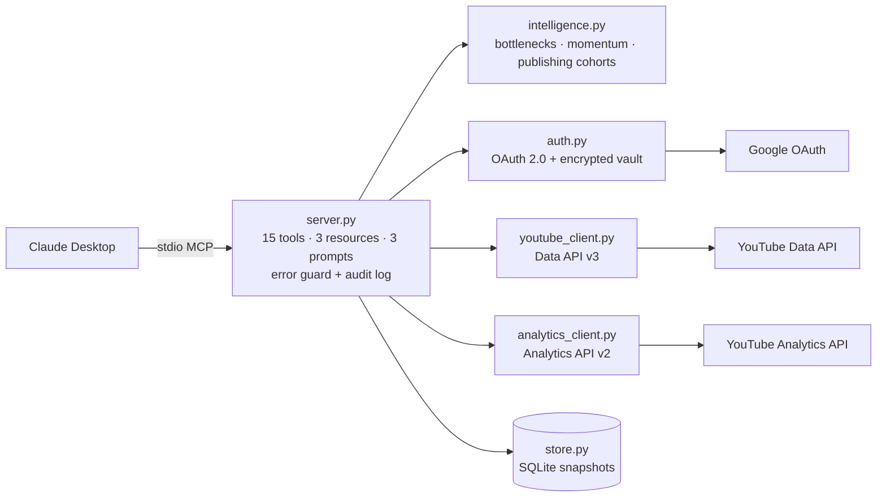

## Documentation Wiki

The complete project wiki is available in [docs/wiki](docs/wiki/Home.md), including setup, user guidance, MCP reference, architecture, security, troubleshooting, roadmap and contribution standards.

<!-- CreatorOS repository banner -->
<p align="center">
  
</p>

# CreatorOS – YouTube Creator Intelligence for Claude

  -purple)  

## Description

CreatorOS connects Claude to **your own YouTube channel** and turns your analytics into clear, evidence-based answers:
how the channel is doing, what is holding each video back, what to replicate, when to publish, and what your audience is asking.

It is a **read-only** local extension for Claude Desktop. It never uploads, edits, deletes or comments, and your data
never passes through any CreatorOS server — only between your computer, Google and Claude.

Every answer is labelled so you know what is fact and what is a suggestion:

| Label | Meaning |
|---|---|
| `measured` | Read directly from YouTube |
| `derived` | Arithmetic on measured data (ratios, % change, medians) |
| `estimated` | Pattern inference from your history, with a confidence level |
| `ai_recommendation` | A suggested action to test — not a proven cause |

## Features

- **Channel health check** – compares every video with your own same-format baseline (Shorts vs Shorts, long-form vs long-form) and names the real bottleneck: *click*, *discovery*, *retention* or *subscriber conversion*, then gives one prioritized recommendation.
- **Private analytics** – views, watch time, average view %, subscribers gained/lost, traffic sources, countries, subscriber vs non-subscriber viewing, period-over-period change.
- **Video deep dive** – audience-retention curve with the biggest drop-off, discovery sources, YouTube search terms.
- **Fair comparisons** – each video measured over its own first N days after publishing.
- **Rising & declining videos** – momentum versus the previous period.
- **Best time to publish** – estimated from how your past uploads performed, with confidence and sample sizes.
- **Audience voice** – the questions viewers ask in your comments.
- **Library search** – find your videos by topic without using YouTube quota.
- **History** – snapshots and past recommendations saved locally so you can check advice against results.
- **Multi-channel** – connect several channels and switch the default.

## Installation

CreatorOS runs **on your computer**, so it works in **Claude Cowork** (desktop app) and **Claude Code**. It does not run in claude.ai web chat (local servers are not loaded there).

**Prerequisites for the plugin:** Python 3.10+ on your PATH, and the `uv` Python runner (one-time, 1 minute). CreatorOS runs with the exact package versions pinned in `uv.lock`.
- Windows (PowerShell): `powershell -ExecutionPolicy ByPass -c "irm https://astral.sh/uv/install.ps1 | iex"`
- macOS: `curl -LsSf https://astral.sh/uv/install.sh | sh`

### Option 0 — Claude plugin (Cowork and Claude Code)

- **From the Claude directory** (once listed): **Customize → Browse plugins**, search *CreatorOS*, click **Add**.
- **Cowork, before listing:** on GitHub click **Code → Download ZIP**, then in Claude **Customize → Plugins → Add → Upload plugin** and choose the ZIP.
- **Claude Code:** `claude --plugin-dir ./youtube-claude-mcp` (from a clone of this repo).

The plugin adds the CreatorOS server and a **youtube-channel-review** skill that teaches Claude which tool to use for each question. Then complete [Configuration](#configuration).

### Option A — Claude Desktop extension

1. Download the **`.mcpb`** file from the [latest release](https://github.com/mattey2026/youtube-claude-mcp/releases/latest).
2. Double-click it (or drag it into Claude Desktop, or **Settings → Extensions → Install Extension**).
3. Review the permissions and click **Install**.
4. Complete [Configuration](#configuration) below.

Claude Desktop installs the Python runtime and dependencies automatically.
Once listed in the Anthropic Directory: **Settings → Extensions → Browse**, search *CreatorOS*, click **Install**.

### Option B — Manual install (developers)

Requires Python 3.10+.

**Windows** (Command Prompt):
```bat
cd "%USERPROFILE%\Documents"
git clone https://github.com/mattey2026/youtube-claude-mcp.git
cd youtube-claude-mcp
python -m venv .venv
.venv\Scripts\python -m pip install --upgrade pip
.venv\Scripts\pip install -e .
```
**macOS** (Terminal):
```bash
cd ~/Documents && git clone https://github.com/mattey2026/youtube-claude-mcp.git
cd youtube-claude-mcp && python3 -m venv .venv
.venv/bin/pip install --upgrade pip && .venv/bin/pip install -e .
```
> If Documents is synced by OneDrive on Windows, the path is `%USERPROFILE%\OneDrive\Documents\youtube-claude-mcp`.

Then add to Claude Desktop (**Settings → Developer → Edit Config**), keeping any existing servers:

```json
{
  "mcpServers": {
    "creatoros": {
      "command": "C:\\Users\\YOUR-NAME\\Documents\\youtube-claude-mcp\\.venv\\Scripts\\python.exe",
      "args": ["-m", "creatoros.server"]
    }
  }
}
```
macOS: `"command": "/Users/YOUR-NAME/Documents/youtube-claude-mcp/.venv/bin/python"`. Fully quit and reopen Claude.

## Configuration

CreatorOS uses Google's official APIs. One-time setup (about 15 minutes):

### 1. Google OAuth client (required)

1. Open https://console.cloud.google.com → project dropdown → **New Project** → `CreatorOS` → **Create** → select it.
2. Search and **Enable**: **YouTube Data API v3** and **YouTube Analytics API**.
3. **Google Auth Platform → Get started**: app name `CreatorOS`, your email → **External** → contact email → agree → **Create**.
4. **Audience → Test users → Add users** → the Gmail that owns your channel → **Save**.
5. **Clients → Create client → Desktop app → Create → Download JSON**.
6. Give CreatorOS the client:
   - **Plugin (Cowork / Claude Code):** when you enable the plugin, Claude asks for **Google OAuth Client ID** and **Client Secret** — copy both from the client's page in Google Cloud. The secret is kept in secure storage.
   - **Extension:** Settings → Extensions → CreatorOS → **Configure** → *Google OAuth client file* → select the JSON.
   - **Manual install:** save it as `client_secret.json` in the `.creatoros` folder of your user directory
     (Windows: `move "%USERPROFILE%\Downloads\client_secret_*.json" "%USERPROFILE%\.creatoros\client_secret.json"` after `mkdir "%USERPROFILE%\.creatoros"`).

> While the Google app is in **Testing** mode, Google asks you to sign in again every 7 days. CreatorOS tells you when.

### 2. YouTube API key (optional — comments only)

YouTube only allows comment reading through OAuth with a *write-capable* permission, which CreatorOS deliberately does not request.
1. **APIs & Services → Credentials → + Create credentials → API key**, name `CreatorOS Comments`.
2. **API restrictions:** select **YouTube Data API v3**. **Application restrictions:** None. **Create**, copy the key.
3. **Plugin:** enter it in the plugin's *YouTube Data API key* setting. **Extension:** Configure → *YouTube Data API key*. **Manual:** save it in `.creatoros\api_key.txt`.

### 3. Connect your channel

Ask Claude: *"Connect my YouTube channel with CreatorOS."* A Google sign-in tab opens → choose the account/channel →
if shown, **"Google hasn't verified this app" → Continue** → tick both permissions → **Continue**.
(Manual install alternative: run `.venv\Scripts\creatoros-connect`.)

## Examples

### Example 1: Channel health check
**User prompt:** "Use CreatorOS to run a full health check on my YouTube channel for the last 28 days. Tell me the main bottleneck, the evidence, and three things to do this week."

**Expected behavior:**
- Calls `youtube_analyze_channel_performance` (syncs videos, pulls this and the previous 28 days).
- Returns views, watch time, retention and net subscribers with % change; top traffic sources and countries.
- Classifies each recent video's bottleneck against your own same-format median, and names a main bottleneck only if it affects ≥30% of recent videos.
- Gives 3 concrete actions, videos to replicate, a confidence level and the limitations (e.g. ~48h data lag).

### Example 2: Compare videos fairly
**User prompt:** "Compare my two most-viewed videos over their first 28 days after publishing."

**Expected behavior:**
- Calls `youtube_list_videos` (sort: most viewed), then `youtube_compare_videos` with `first_days=28`.
- Shows views, average % viewed, subscribers per 1,000 views and likes per 1,000 views for each video in equal windows.
- Names the leader per metric and warns if formats differ (Short vs long-form) or a window is partial.

### Example 3: Video deep dive
**User prompt:** "Analyze my most recent video: where do viewers drop off, how did people find it, and what search terms brought them?"

**Expected behavior:**
- Calls `youtube_get_video_analytics` for the video's lifetime.
- Returns a 20-point retention curve with the biggest drop-off (time in seconds), traffic sources and YouTube search terms.
- States clearly when YouTube has no data for a report (e.g. too few views for search terms).

### Example 4: Best time to publish
**User prompt:** "When should I publish my next Short? My audience is mostly in India."

**Expected behavior:**
- Calls `youtube_recommend_publishing_time` with `timezone_name="Asia/Kolkata"`, `format="short"`.
- Returns weekday and 3-hour time-block rankings with sample sizes, the best slot and confidence, your current habit, untested days and how to validate.
- If no slot has 3+ comparable videos, says so instead of guessing.

### Example 5: What the audience is asking
**User prompt:** "Read the comments on my most-commented video. What questions are viewers asking?"

**Expected behavior:**
- Calls `youtube_list_videos` then `youtube_get_comments`.
- Lists the most-liked comments and viewer questions, with the share of comments that are questions.
- If no API key is configured, returns a `[configuration]` message explaining how to add one.

More prompts: *"Which videos are rising or declining?"*, *"Search my videos about AI"*, *"Run my weekly creator review"*.

## Tools

All tools are annotated for the Anthropic Directory: `readOnlyHint` (12 tools) or `destructiveHint` (3 tools that write only local files).

| Tool | Annotation | What it does |
|---|---|---|
| `youtube_connect_channel` | destructive (local) | Google sign-in; saves an encrypted token |
| `youtube_list_channels` | read-only | Connected channels and default |
| `youtube_set_default_channel` | destructive (local) | Choose the default channel |
| `youtube_disconnect_channel` | destructive (local) | Revoke Google access + delete token; requires `confirm=true` |
| `youtube_get_channel_overview` | read-only | Profile, stats, format mix, upload cadence |
| `youtube_list_videos` | read-only | Videos with filters, sorting, pagination |
| `youtube_search_videos` | read-only | Search your own library (no quota) |
| `youtube_get_video_details` | read-only | Full metadata + stored stat history |
| `youtube_get_comments` | read-only | Comments, viewer questions, most-liked |
| `youtube_get_channel_analytics` | read-only | Private analytics vs previous period |
| `youtube_get_video_analytics` | read-only | Retention curve, drop-off, traffic, search terms |
| `youtube_compare_videos` | read-only | Equal-window comparison |
| `youtube_analyze_channel_performance` | read-only | Full health check + one recommendation |
| `youtube_recommend_publishing_time` | read-only | Best day/time with confidence |
| `youtube_get_recommendation_history` | read-only | Past recommendations and baselines |

**Prompts:** `channel_health_assessment`, `weekly_creator_review`, `video_performance_analysis`.
**Resources:** `creatoros://channels`, `creatoros://channels/{id}/videos`, `creatoros://channels/{id}/recommendations`.

## Privacy Policy

CreatorOS runs locally and has no servers or telemetry. Full policy: **https://matteys.com/creatoros/privacy** (source: [PRIVACY.md](PRIVACY.md)).

### Data collection
- **Accessed (read-only, with your Google consent):** channel info, video metadata and public counts, private YouTube Analytics for your own channel, and public comments (only with an API key).
- **Use:** only to answer your questions in Claude. Never for ads, profiling or training.
- **Storage:** on your computer in `.creatoros` — encrypted Google tokens, a local SQLite history, and logs without secrets.
- **Sharing:** with Google (to fetch the data) and with Claude (tool results you request). Not with the publisher or anyone else.
- **Retention:** until you delete it. Disconnect with `youtube_disconnect_channel` or https://myaccount.google.com/permissions; delete the `.creatoros` folder to erase everything.

CreatorOS's use of information received from Google APIs adheres to the [Google API Services User Data Policy](https://developers.google.com/terms/api-services-user-data-policy), including the Limited Use requirements.

## Support

- Issues and feature requests: https://github.com/mattey2026/youtube-claude-mcp/issues
- Email: sumit@matteys.com
- Logs for bug reports: `.creatoros/logs/server.log` and `tool_calls.jsonl` (they contain no tokens or keys).

## Troubleshooting

Every error starts with a category and a fix:

| Message starts with | Meaning | Fix |
|---|---|---|
| `[configuration]` client file not found | OAuth client not set | Configuration → step 1.6 |
| `[configuration]` API not enabled | APIs not enabled | Enable both YouTube APIs |
| `[configuration]` API key | Comments need a key | Configuration → step 2 |
| `[authentication]` | Sign-in expired (7-day testing limit) or revoked | Ask Claude to connect again |
| `[permission]` | Wrong Google account / Brand Account | Reconnect and pick the channel owner |
| `[quota]` | Daily Google quota used | Wait until midnight US Pacific time |
| `[unavailable_data]` | YouTube has no data for that request | Longer period or another video |
| `[system]` | Temporary Google or network error (auto-retried 3×) | Try again shortly |
| Windows: `The system cannot find the path specified` | Documents is in OneDrive | Use the OneDrive path |

## Compatibility

Claude Desktop ≥ 0.10 on Windows, macOS and Linux · Python ≥ 3.10 (managed automatically for the extension).
Live-tested on Windows 11 with a real channel; see [Verification](#verification-status).

---

# Architecture



| Layer | Module | Responsibility |
|---|---|---|
| MCP interface | `creatoros/server.py` | Tools, resources, prompts, uniform errors, audit log |
| Intelligence | `creatoros/intelligence.py` | Pure, unit-tested analytics engine |
| YouTube Data | `creatoros/youtube_client.py` | Channel, uploads, videos, comments (quota-aware) |
| YouTube Analytics | `creatoros/analytics_client.py` | Private metrics, optional reports degrade gracefully |
| Auth | `creatoros/auth.py` | OAuth (PKCE), encrypted multi-channel vault, revoke |
| Persistence | `creatoros/store.py` | Append-only snapshots with provenance |
| Errors | `creatoros/errors.py` | Category + fix for every failure |

Detailed design: [docs/ARCHITECTURE.md](docs/ARCHITECTURE.md) (feasibility matrix, scopes, methods, roadmap) ·
[docs/SOLUTION_AND_TECHNICAL_ARCHITECTURE.md](docs/SOLUTION_AND_TECHNICAL_ARCHITECTURE.md) (solution & technical diagrams) ·
[docs/SUBMISSION.md](docs/SUBMISSION.md) (directory checklist).

## How the intelligence works

**Bottleneck diagnosis** — each video vs the median of the same format on your channel:

| Pattern | Bottleneck |
|---|---|
| impressions ≥ 0.8× and CTR < 0.8× (when YouTube provides CTR) | Click |
| views < 0.6× and retention ≥ 1.0× | Discovery |
| views < 0.6× and retention < 0.85× | Discovery + consumption |
| views ≥ 0.8× and retention < 0.8× | Consumption |
| views ≥ 0.8× and subscribers/1k views < 0.6× | Conversion |
| views ≥ 1.5× and retention ≥ 0.95× | Winning |

**Publishing time** — each video's views ÷ the median of its 10 nearest same-format uploads by date (controls for growth and age),
grouped by weekday and 3-hour block in the audience timezone; a slot needs ≥ 3 videos. YouTube Studio's
"when your viewers are on YouTube" chart is **not** available through the public API, so this is an outcome-based estimate.

## Known limitations

- Shorts are detected by duration (≤ 180 s) because the Data API has no Shorts flag.
- Impressions/CTR are requested but YouTube rejects them for some report types; the click stage is then skipped and stated.
- Analytics lag ~48 hours. Per-video analytics cover the top 200 videos per window.
- Competitor research, content ideas, calendar and publishing are later phases (see roadmap).

## Roadmap

| Phase | Scope | Status |
|---|---|---|
| 1 | OAuth, library, analytics, diagnosis, publishing time, comments | **Released (0.3.0, plugin + extension)** |
| 2 | Reporting API history, weekly/monthly reports, native Shorts detection | Next |
| 3 | Transcripts, topic classification, semantic search | Planned |
| 4 | Market & competitor research, SEO, title/thumbnail review, ideation | Planned |
| 5 | Content calendar, approved uploads/scheduling, comment replies | Planned |
| 6 | Hosted remote MCP server (works in claude.ai chat, submit as MCP connector), web app, RBAC | Planned |

## Verification status

| Check | Result |
|---|---|
| 25 offline tests (engine, errors, vault, annotations, stdout safety, stubbed end-to-end) | Pass |
| MCPB manifest validation + pack + launch via `uv` (Claude Desktop method) | Pass |
| `claude plugin validate` (Claude Code 2.1.318, directory checks) | Pass — nothing to report |
| Live run on Windows 11 with a real channel (v0.1.1) | 12/15 pass, 2 later-phase, 1 verified offline; the one failure (transient Google 500) fixed in 0.1.2 with retries |
| macOS clean-machine run | Pending |

## Development

```bash
pip install -e ".[dev]" && pytest -q                 # offline tests
python scripts/acceptance_test.py                    # live acceptance tests on your channel
npm i -g @anthropic-ai/mcpb && mcpb pack . creatoros-youtube.mcpb   # build the extension
```

Project structure:
```
youtube-claude-mcp/
├── .claude-plugin/plugin.json  # Claude plugin manifest (directory listing)
├── .mcp.json              # Plugin's local MCP server definition (python launch.py)
├── launch.py              # Starts the server with uv using pinned versions (uv.lock)
├── uv.lock                # Exact dependency versions
├── skills/youtube-channel-review/SKILL.md  # Workflow skill for Claude
├── manifest.json          # Claude Desktop extension manifest (MCPB 0.4, uv runtime)
├── main.py                # Extension entry point
├── icon.png               # 512×512 icon
├── assets/                # repository banner
├── creatoros/             # Server package (see Architecture)
├── scripts/acceptance_test.py
├── tests/test_creatoros.py
├── docs/                  # ARCHITECTURE, SOLUTION_AND_TECHNICAL_ARCHITECTURE, SUBMISSION
├── PRIVACY.md · CHANGELOG.md · LICENSE
└── pyproject.toml
```

## License

[MIT](LICENSE) © 2026 Sumit Mattey
