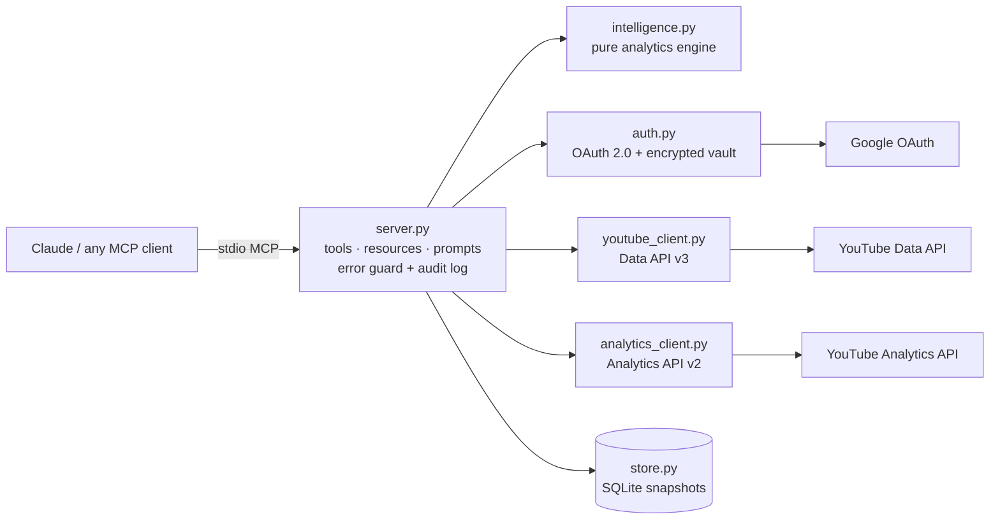

# YouTube Claude MCP — CreatorOS

**YouTube Creator Intelligence for Claude.** Connect your YouTube channel and ask Claude how it is performing,
what is holding it back, and what to do next — answered from your real YouTube data.

   

## Contents
1. [What it does](#what-it-does)
2. [Setup guide (step by step)](#what-you-need-one-time-about-20-minutes)
3. [Tools](#tools)
4. [Troubleshooting](#troubleshooting)
5. [Architecture](#architecture)
6. [Feature-to-API feasibility matrix](#3-feature-to-api-feasibility-matrix-2656)
7. [Intelligence methods](#5-intelligence-methods-phase-1)
8. [Roadmap](#6-roadmap)
9. [Project structure](#project-structure)

## What it does
Connect your YouTube channel to Claude and ask questions like:

- "How is my channel doing, and what should I fix first?"
- "Which videos are rising and which are declining?"
- "Compare my last two videos fairly."
- "When should I publish my next Short?"
- "What are viewers asking in the comments of my latest video?"

Everything answers from **your real YouTube data**. Every result is labelled
`measured`, `derived`, `estimated` or `ai_recommendation`, so you always know what is fact and what is a suggestion.

This version is **read-only**: it cannot upload, edit, delete or comment on anything.

---

## What you need (one time, about 20 minutes)

- A computer (Mac or Windows) with **Claude Desktop** installed.
- **Python 3.10 or newer** — download from https://www.python.org/downloads/
  (Windows: tick **"Add python.exe to PATH"** on the first installer screen).
- The Google account that owns your YouTube channel.

---

## Step 1 — Create your Google access key (Google Cloud)

1. Open https://console.cloud.google.com and sign in with the Google account that owns the channel.
2. Top bar → project picker → **New Project** → name it `CreatorOS` → **Create** → select it.
3. **Enable the APIs.** Left menu → **APIs & Services → Library**. Search and click **Enable** on:
   - **YouTube Data API v3**
   - **YouTube Analytics API**
4. **Consent screen.** Left menu → **Google Auth Platform** (older consoles: *OAuth consent screen*) → **Get started**.
   - App name: `CreatorOS`. Support email: your email. → Next.
   - Audience: **External** → Next. Contact email: your email → Next → Agree → **Create**.
   - Open **Audience** → under **Test users** click **Add users** → add your own Gmail address → Save.
5. **Create the key.** Open **Clients** → **Create client** → Application type **Desktop app** → name `CreatorOS Desktop` → **Create**.
6. Click **Download JSON** on the new client.
7. Rename the downloaded file to exactly **`client_secret.json`** and move it to:
   - Mac: `/Users/YOUR-NAME/.creatoros/client_secret.json`
     (In Finder press **Cmd+Shift+G**, type `~/`, create a folder named `.creatoros`. Press **Cmd+Shift+.** to see hidden folders.)
   - Windows: `C:\Users\YOUR-NAME\.creatoros\client_secret.json`
     (Create the folder `.creatoros` inside your user folder.)

> While the app stays in Google's **Testing** mode, Google asks you to reconnect **every 7 days**.
> CreatorOS tells you clearly when that happens. Publishing the app removes this (Phase 6).

---

## Step 2 — Install CreatorOS

Get the code into your **Documents** folder (pick one):

- **Easiest:** on the GitHub page click the green **Code** button → **Download ZIP** → unzip it into Documents and rename the folder to `youtube-claude-mcp` (GitHub adds `-main` to the name).
- **With Git:** `cd ~/Documents && git clone https://github.com/mattey2026/youtube-claude-mcp.git`

**Mac** — open **Terminal** and paste these lines one at a time:

```bash
cd ~/Documents/youtube-claude-mcp
python3 -m venv .venv
.venv/bin/pip install --upgrade pip
.venv/bin/pip install -e .
```

**Windows** — open **Command Prompt** and paste:

```bat
cd %USERPROFILE%\Documents\youtube-claude-mcp
python -m venv .venv
.venv\Scripts\pip install --upgrade pip
.venv\Scripts\pip install -e .
```

---

## Step 3 — Connect your YouTube channel

**Mac:**
```bash
~/Documents/youtube-claude-mcp/.venv/bin/creatoros-connect
```
**Windows:**
```bat
%USERPROFILE%\Documents\youtube-claude-mcp\.venv\Scripts\creatoros-connect
```

A browser tab opens:
1. Choose your Google account.
2. If you manage several channels, pick the right one (Brand Account).
3. You may see **"Google hasn't verified this app"** → click **Continue** (it is your own app).
4. Tick both permission boxes → **Continue**.

The terminal prints `Connected: <your channel name>`. Run the same command again to add more channels.

---

## Step 3b — Add an API key for comments (3 min, optional but recommended)

YouTube only lets apps read comments through OAuth if they hold a **write-capable** permission.
CreatorOS stays read-only, so it reads public comments with a simple API key instead.

1. Google Cloud Console (same `CreatorOS` project) → **APIs & Services → Credentials**.
2. **+ Create credentials → API key**. Copy the key.
3. Click the new key → **API restrictions → Restrict key** → tick **YouTube Data API v3** → **Save**.
4. Save the key in a file named `api_key.txt` inside your `.creatoros` folder:

**Windows** (replace `PASTE-YOUR-KEY` with your key):
```bat
echo PASTE-YOUR-KEY> "%USERPROFILE%\.creatoros\api_key.txt"
```
**Mac:**
```bash
echo "PASTE-YOUR-KEY" > ~/.creatoros/api_key.txt
```

Without the key, every tool except `youtube_get_comments` still works.

---

## Step 4 — Add CreatorOS to Claude Desktop

1. Claude Desktop → **Settings → Developer → Edit Config**. This opens `claude_desktop_config.json`.
2. Replace its contents with the block for your computer (change `YOUR-NAME`).
   If the file already has other servers, add only the `"creatoros"` entry inside `"mcpServers"`.

**Mac:**
```json
{
  "mcpServers": {
    "creatoros": {
      "command": "/Users/YOUR-NAME/Documents/youtube-claude-mcp/.venv/bin/python",
      "args": ["-m", "creatoros.server"]
    }
  }
}
```

**Windows:**
```json
{
  "mcpServers": {
    "creatoros": {
      "command": "C:\\Users\\YOUR-NAME\\Documents\\youtube-claude-mcp\\.venv\\Scripts\\python.exe",
      "args": ["-m", "creatoros.server"]
    }
  }
}
```

3. Save, then **fully quit** Claude Desktop (Mac: Cmd+Q; Windows: right-click tray icon → Quit) and reopen it.
4. In a new chat, click the tools icon — you should see **creatoros** with 15 tools.

---

## Step 5 — Try it

Paste into Claude:

> Use CreatorOS to run a full health check on my YouTube channel for the last 28 days. Tell me the main bottleneck, the evidence, and three things to do this week.

Other good prompts:

- "Which of my videos are rising and which are declining?"
- "Compare my two most-viewed videos over their first 28 days."
- "When should I publish Shorts? My audience is mostly in India."
- "Show me where viewers drop off in my latest video and what the comments ask for."

---

## Step 6 — Run the live acceptance test (recommended)

This checks all 15 acceptance scenarios against your real channel and writes a report.

**Mac:**
```bash
cd ~/Documents/youtube-claude-mcp && .venv/bin/python scripts/acceptance_test.py
```
**Windows:**
```bat
cd %USERPROFILE%\Documents\youtube-claude-mcp && .venv\Scripts\python scripts\acceptance_test.py
```

Open the generated `acceptance_results.md`. Share it back if anything shows **FAIL** — the error text says exactly what went wrong.

---

## Tools

| Tool | What it does |
|---|---|
| `youtube_connect_channel` | Google sign-in, connects a channel (read-only) |
| `youtube_list_channels` | Connected channels and the default |
| `youtube_set_default_channel` | Choose the default channel |
| `youtube_disconnect_channel` | Revoke access + delete token (asks for confirmation) |
| `youtube_get_channel_overview` | Profile, stats, Shorts vs long-form mix, upload cadence |
| `youtube_list_videos` | Your videos with filters, sorting, pagination |
| `youtube_search_videos` | Search your own library (no quota used) |
| `youtube_get_video_details` | Full metadata + stored stat history |
| `youtube_get_comments` | Comments + viewer questions + most-liked |
| `youtube_get_channel_analytics` | Private analytics vs previous period, traffic, countries |
| `youtube_get_video_analytics` | Retention curve, biggest drop-off, traffic, search terms |
| `youtube_compare_videos` | Fair comparison: each video's first N days |
| `youtube_analyze_channel_performance` | **The full health check + one prioritized recommendation** |
| `youtube_recommend_publishing_time` | Best day/time from your own history, with confidence |
| `youtube_get_recommendation_history` | Past recommendations to check against results |

---

## Updating to a new version

1. Download the latest ZIP from GitHub (**Code → Download ZIP**) and extract it.
2. Copy everything from the extracted folder **into** your existing `youtube-claude-mcp` folder and choose **Replace**. Keep your `.venv` folder.
3. In that folder run (Windows): `.venv\Scripts\pip install -e .` — Mac: `.venv/bin/pip install -e .`
4. Fully quit and reopen Claude Desktop.

Your connection, history and keys live in `.creatoros` and are not affected.

---

## Troubleshooting

| Message starts with | Meaning | Fix |
|---|---|---|
| `[configuration]` client_secret.json not found | Step 1.7 not done | Put the file in `.creatoros` with that exact name |
| `[configuration]` API not enabled | Step 1.3 missed | Enable both YouTube APIs |
| `[authentication]` | Sign-in expired (7-day testing limit) | Run `creatoros-connect` again |
| `[permission]` | Wrong Google account / Brand Account | Reconnect and pick the channel owner |
| `[quota]` | Daily Google quota used | Wait until midnight US Pacific time |
| `[unavailable_data]` | YouTube has no data for that request | Try a longer period or another video |
| Tools don't appear in Claude | Config path wrong | Check the path in Step 4 exists; fully restart Claude |
| `The system cannot find the path specified` (Windows) | Documents is inside OneDrive | Use `%USERPROFILE%\\OneDrive\\Documents\\youtube-claude-mcp` |
| `No time zone found with key` | Old install without timezone data | Run `pip install -e .` again (v0.1.1+) |

Logs: `~/.creatoros/logs/server.log` and `tool_calls.jsonl`.

## Privacy and security

- Your Google password never touches CreatorOS — Google's own page handles sign-in.
- Tokens are encrypted on your computer (`~/.creatoros/tokens`) and never sent to Claude.
- Only read-only permissions are requested.
- Disconnect any time with `youtube_disconnect_channel` or at https://myaccount.google.com/permissions.

## For developers

```bash
pip install -e ".[dev]" && pytest -q      # 23 offline tests
```
Architecture, feasibility matrix and roadmap: `docs/ARCHITECTURE.md`.


---

# Architecture

## 1. Repository assessment (Master Prompt §26.1–26.3)

No existing repository or MCP module was provided, so this is a greenfield build.
Stack chosen: **Python 3.10+, official MCP Python SDK 2.x (`MCPServer`), Google API Python client**.
Reason: the most mature official Google client, bundled API discovery documents (works offline at build time),
and a simple install path for non-developers. Module boundaries follow §24 so a TypeScript or hosted
version can replace any layer without touching the others.

## 2. Architecture



| Layer (§24) | Module | Phase 1 | Production target (Phase 6) |
|---|---|---|---|
| YouTube API integration | `youtube_client.py`, `analytics_client.py` | Done | + Reporting API bulk jobs |
| Auth & tokens | `auth.py` | Desktop OAuth, Fernet-encrypted local vault | Web OAuth, KMS-encrypted DB, tenants, RBAC |
| Data ingestion | `server._library` | On-demand sync, 6h cache | Background workers + Redis |
| Persistence | `store.py` | SQLite, append-only snapshots, provenance | PostgreSQL + pgvector |
| Analytics computation | `intelligence.py` | Done (pure functions, unit-tested) | + forecasting, model feedback loop |
| MCP surface | `server.py` | 15 tools, 3 resources, 3 prompts | + streamable HTTP with OAuth |
| Web app | — | Not started | Phase 6 (13 screens, §19) |

## 3. Feature-to-API feasibility matrix (§26.5–26.6)

Legend: **API** = direct official API · **Derived** = computed from API data · **Inferred** = statistical estimate ·
**External** = needs a separate research/search service · **Not possible** = no public API; must not be faked.

| Feature | Source | Feasibility | Notes |
|---|---|---|---|
| Channel profile & public stats | Data API `channels.list` | API | Subscriber count is rounded by YouTube |
| Video inventory | Data API `playlistItems.list` (uploads) | API | 1 quota unit/page (search.list would cost 100) |
| Video metadata, tags, duration | Data API `videos.list` | API | Tags only visible to owner |
| Shorts vs long-form flag | — | Derived | No explicit flag in Data API; duration heuristic ≤180s, labelled. Analytics `creatorContentType` to be evaluated in Phase 2 |
| Comments | Data API `commentThreads.list` | API (API key) | Live test showed `youtube.readonly` is rejected (403 insufficientPermissions); public comments read with an API key to stay read-only. Replies/moderation need `youtube.force-ssl` (Phase 5) |
| Captions / transcript text | Data API `captions.download` | API (owner only) | Needs `youtube.force-ssl`; Phase 3 |
| Views, watch time, AVD, AVP, subs, likes, shares | Analytics `reports.query` | API | ~48h data lag |
| Impressions & CTR | Analytics `videoThumbnailImpressions*` | API (listed in official metrics docs) | Requested optionally; tool reports clearly if a report rejects it |
| Audience retention curve | Analytics `elapsedVideoTimeRatio` | API | One video per query |
| Traffic sources, YouTube search terms | Analytics `insightTrafficSource*` | API | Search terms require video filter |
| Geography, devices, subscriber split | Analytics dimensions | API | |
| Large historical datasets | Reporting API | API | Phase 2 (scheduled jobs) |
| Audience-online heatmap ("when viewers are on YouTube") | — | **Not possible** | Studio-only; replaced by outcome-based cohort inference |
| Best time to publish | Library + Analytics | Inferred | Neighbour-normalized cohorts, confidence score, validation loop |
| Bottleneck diagnosis (journey stages) | Analytics + engine | Derived/Inferred | Compared with channel's own same-format median |
| Content gap, trending topics, competitor topics | Data API public search + external research | External | Phase 4; search.list costs 100 units — needs quota budget |
| Competitor private analytics | — | **Not possible** | Public stats only |
| Native thumbnail A/B test ("Test & Compare") | — | **Not possible via API** | Guide user to Studio |
| Upload, schedule, update metadata, playlists | Data API `videos.insert/update`, `playlists.*` | API | Phase 5, separate scope, explicit confirmation + idempotency |
| Video editing / rendering for Shorts | — | External | Separate media pipeline, not MCP |
| Multimodal video understanding | Owner-provided files + model | External | Phase 3; metadata alone is never presented as video understanding |

## 4. OAuth scopes

| Phase | Scopes | Why |
|---|---|---|
| 1–4 | `youtube.readonly`, `yt-analytics.readonly` | Read channel, videos, comments, private analytics |
| 5 | + `youtube.upload`, `youtube.force-ssl` | Upload/update, captions, comment replies — requested incrementally only when the user enables publishing |
| (optional) | `yt-analytics-monetary.readonly` | Revenue metrics, only if requested |

## 5. Intelligence methods (Phase 1)

**Bottleneck diagnosis** — each video in the window is compared with the *median of the same format* on this channel:

| Pattern | Bottleneck | Stage |
|---|---|---|
| impressions ≥ 0.8× median and CTR < 0.8× median | click | Click |
| views < 0.6× and retention ≥ 1.0× | discovery | Discovery |
| views < 0.6× and retention < 0.85× | packaging_and_content | Discovery + Consumption |
| views ≥ 0.8× and retention < 0.8× | consumption | Consumption |
| views ≥ 0.8× and subs/1k views < 0.6× | conversion | Conversion |
| views ≥ 1.5× and retention ≥ 0.95× | winning | — |

The channel's **primary recommendation** is the most common bottleneck across the 12 most recent analysed videos,
with confidence based on how dominant it is and the sample size. It is saved with its baseline so it can be checked
against later results (`youtube_get_recommendation_history`).

**Publishing time** — each video's views ÷ median views of its 10 nearest same-format videos by publish date
(controls for channel growth and age), grouped by weekday and 3-hour block in the audience timezone.
A slot needs ≥3 videos to qualify. Confidence: high (≥6 videos, ≥30 total, ≥25% lift), medium (≥4, ≥15%), else low.
It also reports your current habit and untested days, because a creator who always posts on one day cannot learn
anything about other days from history alone.

## 6. Roadmap

| Phase | Scope | Status |
|---|---|---|
| 0 | Feasibility, scopes, architecture, acceptance criteria | **Done (this document)** |
| 1 | OAuth, channel discovery, videos, details, search, comments, analytics, performance analysis, publishing time | **Built; offline-tested; awaiting live run on a real channel** |
| 2 | Reporting API ingestion, weekly/monthly reports, subscriber trends, Shorts vs long-form via `creatorContentType` | Next |
| 3 | Transcripts (owner), topic classification, semantic search (pgvector), content journey per series | Planned |
| 4 | External research, competitor watchlists, SEO and title/thumbnail review, ideation | Planned |
| 5 | Calendar, upload/schedule/update with confirmation + idempotency, playlists, comment replies | Planned |
| 6 | Multi-tenant hosted server, web app, RBAC, KMS, Google app verification, monitoring | Planned |

## 7. First end-to-end use case (§26.8)

Connect YouTube → `youtube_list_channels` → `youtube_analyze_channel_performance` →
syncs uploads (Data API) → pulls this and the previous period (Analytics API) → diagnoses each video →
finds rising/declining videos → returns one prioritized, evidence-backed recommendation with confidence and limitations.

## 8. Verification status — honest record

| Check | Result |
|---|---|
| 18 offline unit/plumbing tests (engine, error mapping, encrypted vault, tool registry, confirmation gate, stdout safety, stubbed vertical slice) | Pass |
| Real MCP client over stdio: initialize, list 15 tools / 3 resources / 3 prompts, call tools, structured errors | Pass |
| OAuth request: correct read-only scopes, offline access, PKCE | Pass (URL generation verified) |
| Live run 1 (Windows, 2026-11-04) | 10/15 pass; failures: #8 Windows lacked timezone data (fixed: `tzdata` dependency), #11 comments rejected for read-only scope (fixed: API-key path). Impressions/CTR rejected for these queries — handled as documented limitation. |
| Live run 2 (Windows, v0.1.1) | 12/15 pass, 2 by design (Phases 4-5), 1 verified offline. #12 failed on a transient YouTube 500 error → v0.1.2 adds automatic retries with backoff on all Google calls. Also: health-check headline no longer claims a 'main' bottleneck below 30% of recent videos; publishing-time explains when no slot has 3+ videos |

Acceptance scenarios 9 (ideas) and 10 (calendar) belong to Phases 4 and 5 and are reported as such by the test runner.

---

## Project structure

```
youtube-claude-mcp/
├── creatoros/
│   ├── server.py            # MCP server: 15 tools, 3 resources, 3 prompts, error guard, audit log
│   ├── intelligence.py      # Analytics engine: bottlenecks, momentum, publishing-time cohorts
│   ├── youtube_client.py    # YouTube Data API v3 (channel, videos, comments)
│   ├── analytics_client.py  # YouTube Analytics API v2 (private channel metrics)
│   ├── auth.py              # Google OAuth 2.0 + encrypted token vault, multi-channel
│   ├── store.py             # SQLite history snapshots with provenance
│   ├── errors.py            # Structured error categories with fixes
│   ├── config.py            # Paths, scopes, settings
│   └── connect.py           # `creatoros-connect` command
├── scripts/acceptance_test.py   # 15 live acceptance scenarios -> acceptance_results.md
├── tests/test_creatoros.py      # 23 offline tests
├── docs/ARCHITECTURE.md
└── pyproject.toml
```

## License
Private project of Sumit Mattey. All rights reserved.


## Solution & technical architecture

Architecture documentation, including the current solution architecture, implementation-level technical architecture, channel health data-flow sequence, security boundaries, target-state evolution, and phased roadmap:

**[docs/SOLUTION_AND_TECHNICAL_ARCHITECTURE.md](docs/SOLUTION_AND_TECHNICAL_ARCHITECTURE.md)**
