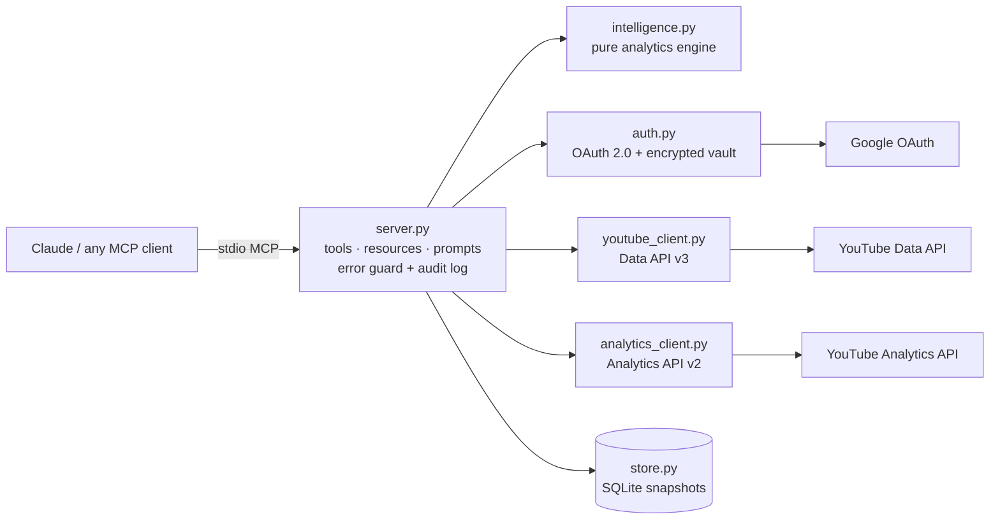

# CreatorOS MCP — Phase 0 Design & Phase 1 Status

## 1. Repository assessment (Master Prompt §26.1–26.3)

No existing repository or MCP module was provided, so this is a greenfield build.
Stack chosen: **Python 3.10+, official MCP Python SDK 2.x (`MCPServer`), Google API Python client**.
Reason: the most mature official Google client, bundled API discovery documents (works offline at build time),
and a simple install path for non-developers. Module boundaries follow §24 so a TypeScript or hosted
version can replace any layer without touching the others.

## 2. Architecture

| Layer (§24) | Module | Phase 1 | Production target (Phase 6) |
|---|---|---|---|
| YouTube API integration | `youtube_client.py`, `analytics_client.py` | Done | + Reporting API bulk jobs |
| Auth & tokens | `auth.py` | Desktop OAuth, Fernet-encrypted local vault | Web OAuth, KMS-encrypted DB, tenants, RBAC |
| Data ingestion | `server._library` | On-demand sync, 6h cache | Background workers + Redis |
| Persistence | `store.py` | SQLite, append-only snapshots, provenance | PostgreSQL + pgvector |
| Analytics computation | `intelligence.py` | Done (pure functions, unit-tested) | + forecasting, model feedback loop |
| MCP surface | `server.py` | 15 tools, 3 resources, 3 prompts | + streamable HTTP with OAuth |
| Web app | — | Not started | Phase 6 (13 screens, §19) |

## 3. Feature-to-API feasibility matrix (§26.5–26.6)

Legend: **API** = direct official API · **Derived** = computed from API data · **Inferred** = statistical estimate ·
**External** = needs a separate research/search service · **Not possible** = no public API; must not be faked.

| Feature | Source | Feasibility | Notes |
|---|---|---|---|
| Channel profile & public stats | Data API `channels.list` | API | Subscriber count is rounded by YouTube |
| Video inventory | Data API `playlistItems.list` (uploads) | API | 1 quota unit/page (search.list would cost 100) |
| Video metadata, tags, duration | Data API `videos.list` | API | Tags only visible to owner |
| Shorts vs long-form flag | — | Derived | No explicit flag in Data API; duration heuristic ≤180s, labelled. Analytics `creatorContentType` to be evaluated in Phase 2 |
| Comments | Data API `commentThreads.list` | API (API key) | Live test showed `youtube.readonly` is rejected (403 insufficientPermissions); public comments read with an API key to stay read-only. Replies/moderation need `youtube.force-ssl` (Phase 5) |
| Captions / transcript text | Data API `captions.download` | API (owner only) | Needs `youtube.force-ssl`; Phase 3 |
| Views, watch time, AVD, AVP, subs, likes, shares | Analytics `reports.query` | API | ~48h data lag |
| Impressions & CTR | Analytics `videoThumbnailImpressions*` | API (listed in official metrics docs) | Requested optionally; tool reports clearly if a report rejects it |
| Audience retention curve | Analytics `elapsedVideoTimeRatio` | API | One video per query |
| Traffic sources, YouTube search terms | Analytics `insightTrafficSource*` | API | Search terms require video filter |
| Geography, devices, subscriber split | Analytics dimensions | API | |
| Large historical datasets | Reporting API | API | Phase 2 (scheduled jobs) |
| Audience-online heatmap ("when viewers are on YouTube") | — | **Not possible** | Studio-only; replaced by outcome-based cohort inference |
| Best time to publish | Library + Analytics | Inferred | Neighbour-normalized cohorts, confidence score, validation loop |
| Bottleneck diagnosis (journey stages) | Analytics + engine | Derived/Inferred | Compared with channel's own same-format median |
| Content gap, trending topics, competitor topics | Data API public search + external research | External | Phase 4; search.list costs 100 units — needs quota budget |
| Competitor private analytics | — | **Not possible** | Public stats only |
| Native thumbnail A/B test ("Test & Compare") | — | **Not possible via API** | Guide user to Studio |
| Upload, schedule, update metadata, playlists | Data API `videos.insert/update`, `playlists.*` | API | Phase 5, separate scope, explicit confirmation + idempotency |
| Video editing / rendering for Shorts | — | External | Separate media pipeline, not MCP |
| Multimodal video understanding | Owner-provided files + model | External | Phase 3; metadata alone is never presented as video understanding |

## 4. OAuth scopes

| Phase | Scopes | Why |
|---|---|---|
| 1–4 | `youtube.readonly`, `yt-analytics.readonly` | Read channel, videos, comments, private analytics |
| 5 | + `youtube.upload`, `youtube.force-ssl` | Upload/update, captions, comment replies — requested incrementally only when the user enables publishing |
| (optional) | `yt-analytics-monetary.readonly` | Revenue metrics, only if requested |

## 5. Intelligence methods (Phase 1)

**Bottleneck diagnosis** — each video in the window is compared with the *median of the same format* on this channel:

| Pattern | Bottleneck | Stage |
|---|---|---|
| impressions ≥ 0.8× median and CTR < 0.8× median | click | Click |
| views < 0.6× and retention ≥ 1.0× | discovery | Discovery |
| views < 0.6× and retention < 0.85× | packaging_and_content | Discovery + Consumption |
| views ≥ 0.8× and retention < 0.8× | consumption | Consumption |
| views ≥ 0.8× and subs/1k views < 0.6× | conversion | Conversion |
| views ≥ 1.5× and retention ≥ 0.95× | winning | — |

The channel's **primary recommendation** is the most common bottleneck across the 12 most recent analysed videos,
with confidence based on how dominant it is and the sample size. It is saved with its baseline so it can be checked
against later results (`youtube_get_recommendation_history`).

**Publishing time** — each video's views ÷ median views of its 10 nearest same-format videos by publish date
(controls for channel growth and age), grouped by weekday and 3-hour block in the audience timezone.
A slot needs ≥3 videos to qualify. Confidence: high (≥6 videos, ≥30 total, ≥25% lift), medium (≥4, ≥15%), else low.
It also reports your current habit and untested days, because a creator who always posts on one day cannot learn
anything about other days from history alone.

## 6. Roadmap

| Phase | Scope | Status |
|---|---|---|
| 0 | Feasibility, scopes, architecture, acceptance criteria | **Done (this document)** |
| 1 | OAuth, channel discovery, videos, details, search, comments, analytics, performance analysis, publishing time | **Released 0.2.0 (Claude Desktop extension)** |
| 2 | Reporting API ingestion, weekly/monthly reports, subscriber trends, Shorts vs long-form via `creatorContentType` | Next |
| 3 | Transcripts (owner), topic classification, semantic search (pgvector), content journey per series | Planned |
| 4 | External research, competitor watchlists, SEO and title/thumbnail review, ideation | Planned |
| 5 | Calendar, upload/schedule/update with confirmation + idempotency, playlists, comment replies | Planned |
| 6 | Multi-tenant hosted server, web app, RBAC, KMS, Google app verification, monitoring | Planned |

## 7. First end-to-end use case (§26.8)

Connect YouTube → `youtube_list_channels` → `youtube_analyze_channel_performance` →
syncs uploads (Data API) → pulls this and the previous period (Analytics API) → diagnoses each video →
finds rising/declining videos → returns one prioritized, evidence-backed recommendation with confidence and limitations.

## 8. Verification status — honest record

| Check | Result |
|---|---|
| 25 offline unit/plumbing tests (engine, error mapping, encrypted vault, tool registry, confirmation gate, stdout safety, stubbed vertical slice) | Pass |
| Real MCP client over stdio: initialize, list 15 tools / 3 resources / 3 prompts, call tools, structured errors | Pass |
| OAuth request: correct read-only scopes, offline access, PKCE | Pass (URL generation verified) |
| Live run 1 (Windows, 2026-11-04) | 10/15 pass; failures: #8 Windows lacked timezone data (fixed: `tzdata` dependency), #11 comments rejected for read-only scope (fixed: API-key path). Impressions/CTR rejected for these queries — handled as documented limitation. |
| Live run 2 (Windows, v0.1.1) | 12/15 pass, 2 by design (Phases 4-5), 1 verified offline. #12 failed on a transient YouTube 500 error → v0.1.2 adds automatic retries with backoff on all Google calls. Also: health-check headline no longer claims a 'main' bottleneck below 30% of recent videos; publishing-time explains when no slot has 3+ videos |

Acceptance scenarios 9 (ideas) and 10 (calendar) belong to Phases 4 and 5 and are reported as such by the test runner.
