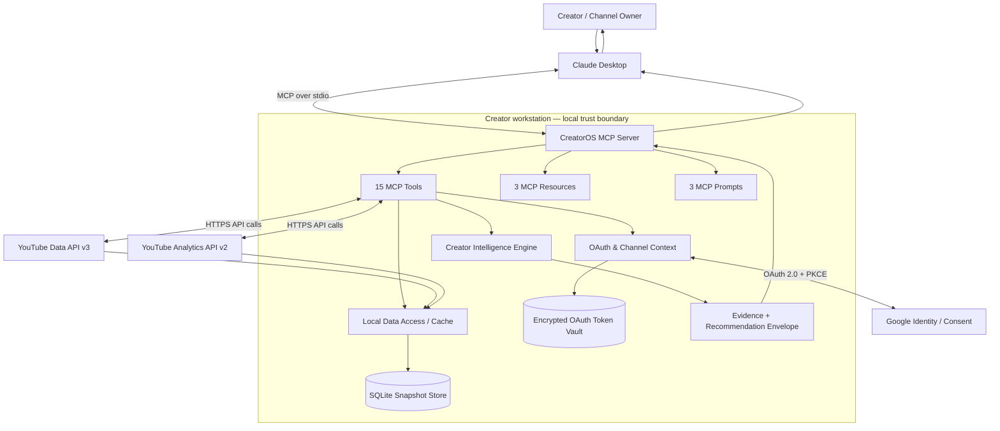
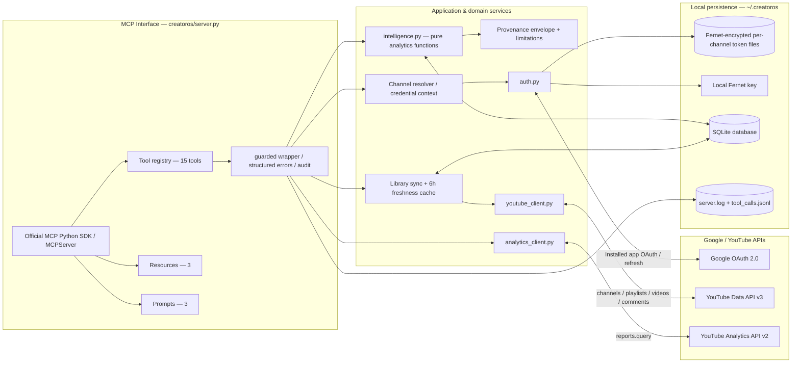
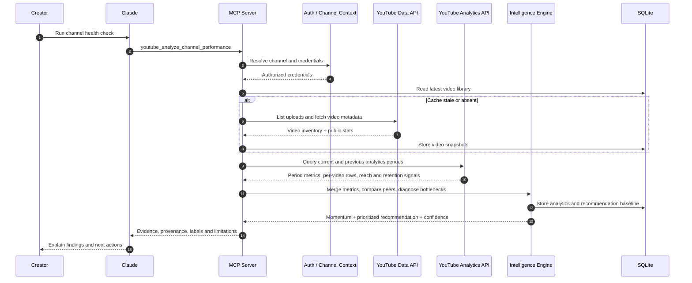
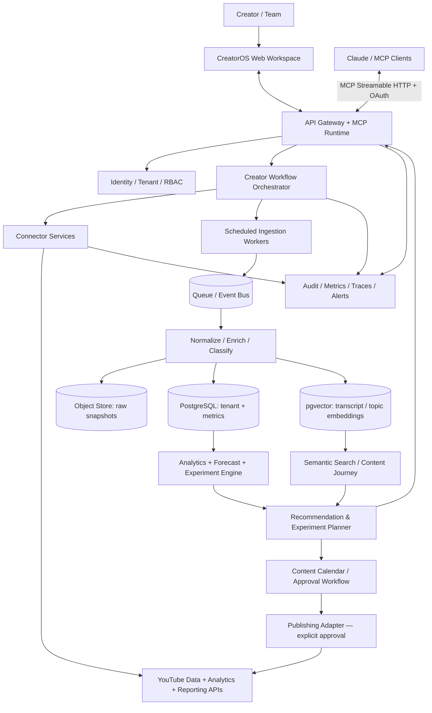

# CreatorOS — Solution & Technical Architecture

> Architecture documentation for the current Phase 1 implementation and the recommended target evolution. The diagrams deliberately distinguish implemented components from roadmap capabilities.

## 1. Product overview

CreatorOS is a local-first, read-only YouTube Creator Intelligence MCP server. It connects a user's channel through Google OAuth, retrieves owned-channel metadata and private analytics from official YouTube APIs, persists local snapshots, computes deterministic performance signals, and exposes the results to Claude through MCP tools, resources, and prompts.

It is not yet a hosted SaaS, publishing platform, content generation engine, competitor intelligence crawler, or full creator operating system. Those belong to later phases.

## 2. Solution architecture — current Phase 1

### User value chain

1. Connect one or more owned YouTube channels.
2. Discover the channel and synchronize its uploads library.
3. Retrieve public metadata, comments, channel analytics, per-video analytics, retention, traffic sources and search terms where supported.
4. Compare performance against the channel's own same-format baselines and previous periods.
5. Identify rising/declining videos and likely funnel bottlenecks.
6. Recommend a publishing day/time using historical cohort evidence and confidence labels.
7. Present measured, derived, estimated and AI-recommendation outputs distinctly.

## 3. Technical architecture — current implementation

## 4. Component responsibilities

| Component | Responsibility | Current design |
|---|---|---|
| MCP server | Claude-facing contract | stdio; 15 tools, 3 resources, 3 prompts |
| OAuth / auth | Consent, refresh, channel selection, disconnect | Desktop OAuth; read-only scopes; per-channel encrypted token |
| YouTube Data adapter | Channel, uploads playlist, video metadata, comments | Official Data API v3 |
| Analytics adapter | Views, watch time, retention, reach, traffic, countries, search terms | Official Analytics API v2 |
| Library sync | Normalize and cache owned video inventory | On demand; 6-hour TTL; up to 500 videos |
| Intelligence engine | Peer baselines, bottleneck diagnosis, momentum, publishing cohorts | Deterministic/pure functions |
| Persistence | Historical snapshots and recommendation history | Local SQLite |
| Reliability layer | Error categories, audit log, provenance, limitations | Guarded tool wrapper |
| Packaging | Local installation and MCP launch | Python package + CLI entry points |

## 5. Data flow: channel health assessment

## 6. Security, privacy and trust boundaries

- OAuth credentials are obtained through Google's consent screen; CreatorOS does not handle the Google password.
- Current scopes are `youtube.readonly` and `yt-analytics.readonly`; no upload, edit, delete or comment-write scope is requested in Phase 1.
- Tokens are encrypted with Fernet before being written to per-channel files. The generated key is stored locally with restrictive file permissions where supported.
- The database and logs remain on the workstation under `~/.creatoros`.
- Tool outputs should retain the provenance fields and measured/derived/estimated/AI-recommendation labels.
- Disconnect requires explicit confirmation, attempts remote grant revocation, and removes the local token file.

**Hardening before broader distribution:** document and implement key backup/recovery and rotation, avoid logging content or sensitive identifiers unnecessarily, add data retention/purge controls, add dependency/security scanning, and validate encrypted key-file access controls on Windows/macOS. Local encryption protects tokens at rest against casual file disclosure; it is not equivalent to a managed hardware-backed secret store if an attacker controls the logged-in workstation.

## 7. Intelligence design

| Capability | Method | Interpretation |
|---|---|---|
| Period-over-period performance | Current window vs previous equal-length window | Measured API data + derived percentage change |
| Momentum | Compare current vs previous period per video | Rising, declining, newly active |
| Bottleneck diagnosis | Compare CTR/views/retention/subscriber conversion with same-format channel medians | Derived diagnosis; not proof of causality |
| Publishing-time recommendation | Normalize a video's views against nearest same-format peers, bucket by weekday and 3-hour block | Estimated association; confidence depends on sample size |
| Audience questions | Extract question-shaped top-level comments | Derived signal, not full semantic intent analysis |
| Retention drop-off | Find largest decline in the sampled retention curve | Derived diagnostic signal |

The publishing-time engine must not be described as YouTube's native "when your viewers are on YouTube" heatmap. It is a historical performance inference based on the creator's own uploads.

## 8. API and product feasibility boundaries

| Capability | Status |
|---|---|
| Owned channel profile, video library, public counters, comments | Current API-backed |
| Owned-channel private analytics, retention and traffic sources | Current API-backed where the requested report is available |
| Channel health / bottlenecks / momentum / publishing-time inference | Current derived or estimated |
| Transcript ingestion and semantic content journey | Planned Phase 3 |
| Topic clustering and series-level content journey | Planned Phase 3 |
| External trend and competitor topic research | Planned Phase 4; needs separate research/search provider and quota controls |
| Content calendar and publishing workflow | Planned Phase 5 |
| Upload / schedule / metadata edits / comment replies | Planned Phase 5; separate scopes and explicit confirmation |
| Hosted multi-tenant service / RBAC / web app | Planned Phase 6 |
| Competitor private analytics and Studio-only audience-online heatmap | Not available through the public APIs; must not be fabricated |

## 9. Target evolution architecture — proposed, not yet implemented

### Target-state architecture principles

1. Keep MCP as the agent interface, not the core business logic. All meaningful operations should be domain services callable by MCP and the future web UI.
2. Introduce a tenant-aware identity boundary before hosting multiple creators or teams.
3. Separate raw source data, normalized facts, derived metrics, embeddings and recommendations; preserve lineage and model/version metadata.
4. Move scheduled sync and long-running analysis into idempotent background jobs; use queues and bounded retries.
5. Treat recommendations as hypotheses with evidence, sample size, confidence and outcome tracking.
6. Introduce a human approval gate for every write action. Use separate incremental OAuth scopes and idempotency keys for publish operations.
7. Enforce quota budgets, caching, backoff and API-cost observability per tenant.
8. Keep the local-first deployment as a supported option even after a hosted model exists.

## 10. Priority roadmap

| Priority | Recommended work | Why |
|---|---|---|
| P0 | Run the live acceptance suite on a real channel; verify OAuth test-user/Brand Account flows; fix any report/API edge cases | Closes the largest validation gap |
| P0 | Add CI for supported Python versions, lint/type checks, dependency audit and test coverage | Make changes reproducible and regression-safe |
| P1 | Phase 2: Reporting API ingestion and scheduled weekly/monthly snapshots | Better historical depth and less on-demand API pressure |
| P1 | Phase 3: transcripts, topic taxonomy, series/content journey and semantic retrieval | Moves from reporting to content intelligence |
| P1 | Recommendation outcome ledger: record action taken, target metric, observation window and result | Makes recommendation quality measurable |
| P2 | Phase 4: external trend/competitor research with provenance and quota budget | Adds market context without pretending private competitor data exists |
| P2 | Phase 5: calendar and write workflow with dry-run, confirmation, idempotency and audit | Safely closes the insight-to-action loop |
| P3 | Phase 6: hosted tenancy, RBAC, KMS, web workspace, observability and Google verification | Enables multi-user scale |

## 11. Architecture decision record (summary)

- **Local-first Python** is appropriate for the first creator-facing vertical slice because it minimizes hosting complexity and keeps OAuth tokens on the user's machine.
- **MCP is the agent integration contract**; domain logic is kept in modules so a future web UI or other agent can reuse it.
- **SQLite is sufficient for single-workstation history**; move to Postgres only when multi-user / concurrent workloads require it.
- **Rule-based, explainable analytics** are appropriate before ML forecasting; establish data quality and feedback labels before training predictive models.
- **Read-only by default** is the correct security posture; publishing should be a separately authorized capability with an explicit human approval gate.

## 12. Verification status

The current repository's documentation reports 18 offline tests passing and MCP stdio initialization/list/call plumbing verified. The live Google API acceptance test against a real channel is explicitly marked as not yet run. Treat the Phase 1 implementation as an implemented vertical slice awaiting live integration validation, not a production-certified service.
