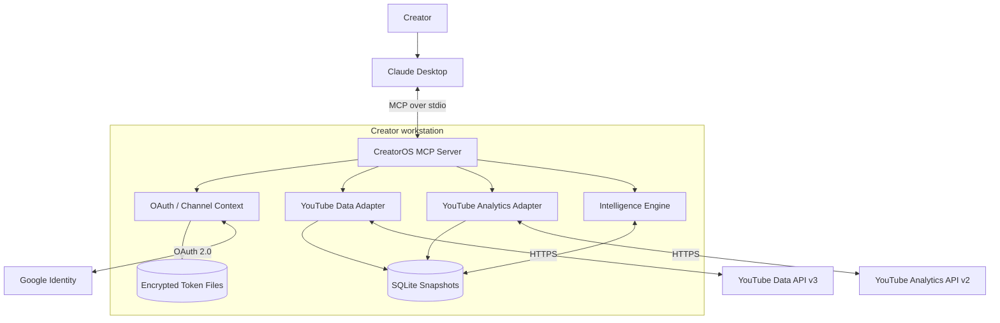

# Architecture

This page summarizes the current implementation and target evolution. The full technical design is maintained in [Solution & Technical Architecture](../SOLUTION_AND_TECHNICAL_ARCHITECTURE.md).

## 1. Current architecture

CreatorOS is a local-first Python MCP server. Claude communicates with it through MCP over stdio. The server coordinates Google OAuth, YouTube API clients, local persistence and an intelligence layer.

## 2. Technology stack

| Area | Current technology |
|---|---|
| Language | Python 3.10+ |
| MCP | Official MCP Python SDK 2.x |
| YouTube metadata | YouTube Data API v3 |
| Private analytics | YouTube Analytics API v2 |
| Authentication | Google OAuth 2.0 desktop installed-app flow |
| Local database | SQLite |
| Token encryption | Fernet |
| Transport | MCP stdio |

## 3. Main modules

| Module | Responsibility |
|---|---|
| `creatoros/server.py` | MCP tools, resources, prompts, error guard and audit |
| `auth.py` | OAuth, token refresh, channel context and disconnect |
| `youtube_client.py` | YouTube Data API integration |
| `analytics_client.py` | YouTube Analytics API reports |
| `intelligence.py` | Performance comparisons, diagnosis, momentum and publishing cohorts |
| `store.py` | Local SQLite snapshots, history and synchronization state |

## 4. Data flow

1. Claude invokes an MCP tool.
2. CreatorOS resolves the selected channel and local credentials.
3. The relevant adapter retrieves API data or uses a valid local cache.
4. The store persists snapshots and history.
5. The intelligence engine computes comparisons and recommendations.
6. The MCP server returns structured results with evidence and provenance.

## 5. Data and trust boundaries

- Google OAuth handles user authentication.
- CreatorOS stores encrypted OAuth tokens locally.
- YouTube Data and Analytics APIs are external trust boundaries.
- SQLite and logs are local to the user's workstation.
- Claude receives tool results through the MCP client connection.

## 6. Current vs proposed architecture

| Capability | Current Phase 1 | Proposed future |
|---|---|---|
| Runtime | Local Python MCP | Optional hosted MCP and web workspace |
| Persistence | SQLite | PostgreSQL and object storage if justified |
| Ingestion | On-demand sync and cache | Scheduled workers and incremental ingestion |
| Search | Local library keyword search | Transcript indexing and semantic search |
| Intelligence | Deterministic comparisons and cohort estimates | Forecasting, richer topic intelligence and feedback loops |
| Identity | Local OAuth token vault | Tenant-aware identity and RBAC |
| Operations | Local logs and tests | Central observability and managed operations |

Do not introduce queues, distributed services or hosted infrastructure until scale and product requirements justify them.

## 7. Further reading

- [Full Solution and Technical Architecture](../SOLUTION_AND_TECHNICAL_ARCHITECTURE.md)
- [Phase 0 Design and Phase 1 Status](../ARCHITECTURE.md)
- [Security & Privacy](Security-and-Privacy.md)
- [Roadmap](Roadmap.md)
